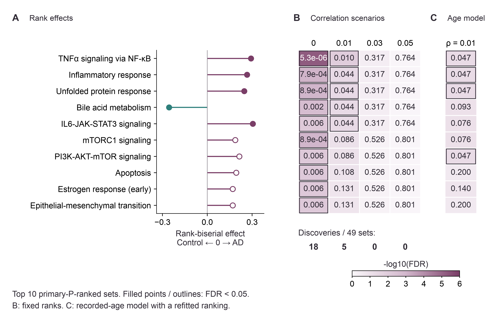

# Donor-level astrocyte programs in Alzheimer's disease

Project period: August 2026.

Zilong Wang | Université Paris-Saclay, Master 2 Bioinformatics & Biostatistics

This project reanalyses public astrocyte expression data from [GSE174367](https://www.ncbi.nlm.nih.gov/geo/query/acc.cgi?acc=GSE174367), published by [Morabito et al. (2021)](https://doi.org/10.1038/s41588-021-00894-z). The question is whether expression differs between Alzheimer's disease (AD) and control donors, and how much the answer changes with the analysis choices.

I processed the published counts into donor-level expression profiles and ran the group comparison. The follow-up analyses examine whether the gene-set findings change after age adjustment, under different gene correlation assumptions, or when individual donors are omitted.

[Report PDF](application/AD_Astrocyte_Research_Report.pdf) · [One-page summary](application/AD_Astrocyte_Research_Summary.pdf) · [Report on GitHub](report/manuscript_source/manuscript.md) · [Supplementary methods and tables](report/manuscript_source/Supplementary_Methods_and_Tables.md)

## What the analysis found

The data contain 4,756 annotated astrocyte nuclei from 18 donors: 11 AD and 7 controls. Counts were combined within each donor, so the comparison uses people as biological replicates.

No individual gene passed BH FDR < 0.05 among 12,331 tested genes. Five of 49 Hallmark gene sets passed under cameraPR's default correlation assumption of 0.01, including inflammatory and protein-stress sets that ranked toward AD. None passed at correlations of 0.03 or 0.05. Age adjustment retained three of the original five sets and identified two additional sets at the threshold.

The original five sets kept their effect directions across all 18 donor omissions, but each passed FDR in only 9-11 omissions. This is a sensitivity result within the same cohort, not independent validation.

## Suggested reading route

1. Start with the [one-page summary](application/AD_Astrocyte_Research_Summary.pdf) for the question and main result.
2. Inspect [Figure 3](results/figures/figure_3_gene_set_enrichment.png) for the effect of correlation and age assumptions, then [Figure S2](results/figures/figure_s2_program_sensitivity.png) for donor influence on the same five sets.
3. Read the [report](report/manuscript_source/manuscript.md) for the donor comparison, gene-level results and interpretation. The [complete gene-set omission results](results/targeted_validation/gene_set_lodo.tsv) include all 49 sets.



## Limits of the comparison

The primary model is unadjusted, and the groups differ in age and sex. Median recorded ages are 89 and 79; ages recorded as 90 mean 90 or older. Two source batch fields disagree. The [donor structure plot](results/figures/figure_s1_donor_structure.png) shows these covariates but does not remove confounding. Combined astrocyte expression can reflect both cell-state proportions and expression within states. The comparison describes this cohort; it does not isolate a disease mechanism.

## Repository contents

| Location | Contents |
|---|---|
| `application/` | Report, one-page summary and application text |
| `scripts/` | Input audit, donor aggregation, statistical analysis, figures and report builder |
| `results/tables/` | Complete primary and donor-omission results |
| `results/sensitivity/` | Correlation and recorded-age sensitivity results |
| `results/targeted_validation/` | Donor structure diagnostics and gene-set donor-omission results |
| `results/figures/` | Four main figures and two supplementary figures in PNG, PDF and SVG formats |
| `data/` | Input URLs, checksums and donor metadata provenance |
| `environment/` | Dependency locks and restoration instructions |
| `tests/` | Synthetic and exported-result consistency checks |

## Check the included results

Restore the pinned [Python and R environments](environment/README.md), then run:

```bash
bash check.sh
```

This runs small synthetic tests and checks the included tables, figures and report claims. It does not download raw data or refit the study. The [validation guide](VALIDATION.md) separates saved-output checks from analysis reruns and explains the historical execution evidence.

## Recompute the two targeted checks

```bash
bash run.sh --targeted-validation --analysis-only
```

This refits the donor-level model, checks agreement with saved results, and computes donor MDS and 18 gene-set omission fits from included pseudobulk counts. It needs the restored analysis environments but no raw-data download or document fonts. It does not repeat the original single-cell processing. Omit `--analysis-only` to also rebuild figures and reports. See the [analysis plan](docs/TARGETED_VALIDATION_PLAN.md) for the fixed specification.

## Reconstruct the analysis

```bash
bash run.sh --download
```

This downloads absent checksummed inputs and rebuilds the workflow sequentially with two numerical threads. Existing inputs are preserved and checked; derived outputs are regenerated, so keep an unchanged copy for comparison. Raw downloads, installed environments, caches and `primary_fit.rds` are omitted from Git; the full run recreates the analysis intermediates.

Add `--analysis-only` to skip rendering and font checks. The optional `--revision-only` mode requires those intermediates from a full run; it is not a fresh-checkout shortcut. Rendering requires installed Times New Roman and Arial files. [Environment instructions](environment/README.md) cover restoration, fonts and platform limits.

## Sources

Counts retain the authors' ASC annotation and Cell Ranger aggregation/read-depth subsampling. The reference label is GRCh38.p12 pre-mRNA; the exact GTF release is unspecified in the original methods. Input provenance and source reuse terms are documented in [data/README.md](data/README.md). Code is distributed under [LICENSE](LICENSE); source data and MSigDB Hallmark sets retain their own terms. The report contains the biological and statistical references.

This project reuses public data and includes no new laboratory experiments.

## Rebuild figures from included results

[Figure reproduction](docs/FIGURE_REPRODUCTION.md) gives plotting-only commands. Figure source hashes, serialized plotting coordinates and layout checks accompany the figures in `results/audit/figure_qa/`.
