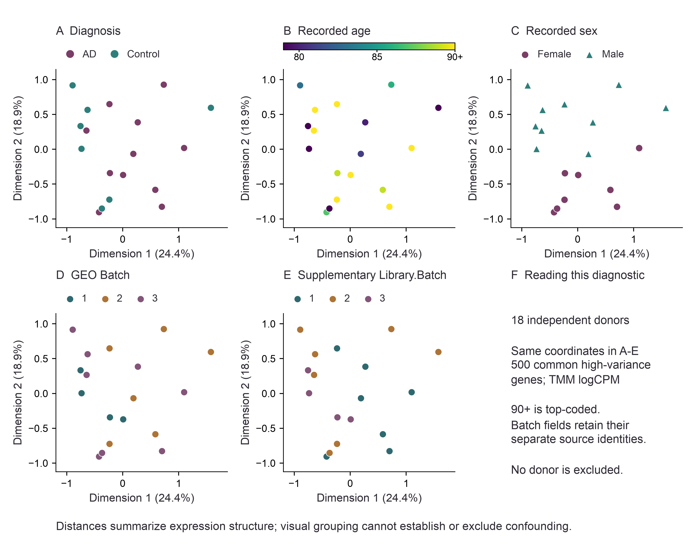
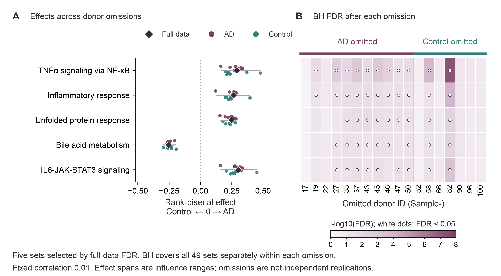

# Supplementary methods and statistical tables

Project period: August 2026.

## Data provenance and primary specification

The reanalysis uses the two processed GSE174367 snRNA-seq files listed in `data/input_manifest.json`, acquired on 29 October 2026 according to the retained acquisition record. The original reference label is `GRCh38.p12.premrna2`; original methods identify Cell Ranger 3.0.2 and pre-mRNA GRCh38.p12, without an exact GTF release. Counts are integers after the authors' aggregation and read-depth subsampling.

The HDF5 contains 58,721 features and 61,770 barcodes. All 61,472 final metadata nuclei match; 298 HDF5-only barcodes are listed explicitly in the audit and excluded because final donor/cell-type annotations are absent. Sorting stored sparse row indices changes representation without changing counts. Aggregating annotated ASC nuclei conserves 40,760,483 UMIs. Gene IDs remain distinct in differential expression; enrichment resolves duplicate symbols by largest primary logCPM, then gene ID.

The primary model is ~ diagnosis, with Control as reference. The coverage rules were fixed before differential-expression results were inspected; the local pre-analysis document is not a registered protocol. R 4.6.1, edgeR 4.10.7 and limma 3.68.5 were used. `filterByExpr` used min.count=10, min.total.count=15, large.n=10 and min.prop=0.7, with the primary design. Filtered library sizes were recomputed. TMM used logratioTrim=0.3, sumTrim=0.05, doWeighting=TRUE and Acutoff=-1e10. The QL fit used robust=TRUE, legacy=FALSE, abundance.trend=TRUE, winsor.tail.p=(0.05,0.1) and prior.count=0.125; NB dispersion was estimated internally from high-abundance genes. The tested coefficient was diagnosisAD. Complete statistics are retained for all 12,331 tested genes; BH correction used that full family.

The original Hallmark 2026.1.Hs collection contains 50 sets. Mapping retains 12,328 unique symbols and 49 sets with 15–500 genes. Pancreas beta cells is excluded because only 14 genes map. Ranking is sign(logFC) × sqrt(QL F). cameraPR uses ranks, directional two-sided competitive testing, and BH across the eligible sets. Its default within-set correlation is 0.01; this is a software default rather than an estimate from these donors. Rank-biserial effect uses average ranks for ties and equals Pr(set gene ranks above a background gene) minus Pr(it ranks below).

## Sensitivity specification

Correlation scenarios and one recorded-age-score model follow the plan in `results/sensitivity/sensitivity_plan.md`, written before those results were inspected. At correlations 0, 0.01, 0.03 and 0.05, the original ranking, symbol mapping and set membership are frozen; BH is applied separately across the same 49 sets in each scenario. All scenarios are reported as fixed assumptions rather than estimates of within-set correlation.

The supplementary model is ~ diagnosis + recorded_age_centered. A value of 90 denotes the source's 90-or-older category; centering the deposited values does not recover unknown ages. The linear capped-score assumption has limited overlap: the sole exactly shared recorded age is the upper category. The design has rank 3, 15 residual degrees of freedom and predictor VIF 1.322. Detailed conditioning and range checks are in `results/sensitivity/design_preflight.json`. Age has no missing values, and no donor is excluded. Sex and batch are tabulated but no further model is fitted. The original gene-filtering decisions, TMM factors, canonical symbols and mapped sets are reused; QL inference is refitted with the additional predictor. Adjusted ranked testing uses the default correlation 0.01.

The LODO analysis keeps the full-data filtered universe and refits TMM plus dispersion after each donor omission. Its 10-gene display is fixed by the smallest full-data raw P values. The maximum displayed change is 0.288 log2FC; EMX2 ranges from -1.053 to -0.846. These are dependent influence summaries of the fixed display panel. Complete LODO tables remain in `results/tables/`.

## Supplementary Table S1. Donor metadata

Values are taken from deposited metadata and the previously verified source supplement. The downloaded metadata and source table do not explicitly state the PMI unit, so its values are reproduced without assigning an inferred unit. NA denotes missing PMI; 90+ denotes top coding, not an exact age. Original supplementary Library.Batch and GEO Batch are retained separately because their assay/stage relationship is unresolved. The source supplement lists a different earlier nucleus total; all nucleus counts here use final deposited annotations.

### Group-level characteristics

| Characteristic | AD | Control |
|---|---|---|
| Donors | 11 | 7 |
| Recorded age, years | 89 (80–90+) | 79 (79–90+) |
| Female / male | 6 / 5 | 2 / 5 |
| PMI (deposited) | 4.170 (2.87–5.00) | 4.125 (1.80–7.00) |
| RIN | 7.9 (6.8–9.3) | 8.1 (7.1–10.0) |
| GEO batch 1 / 2 / 3 | 2 / 4 / 5 | 2 / 2 / 3 |
| Supplementary batch 1 / 2 / 3 | 7 / 2 / 2 | 0 / 5 / 2 |

### Individual donors

| Donor | Diagnosis | Age | Sex | PMI | RIN | Astrocyte nuclei | GEO batch | Supplementary batch |
| --- | --- | --- | --- | --- | --- | --- | --- | --- |
| Sample-17 | AD | 90+ | F | 3.88 | 9.3 | 251 | 3 | 1 |
| Sample-19 | AD | 90+ | F | 4.42 | 6.8 | 317 | 3 | 1 |
| Sample-22 | AD | 86 | M | 4.47 | 7.5 | 154 | 2 | 2 |
| Sample-27 | AD | 81 | M | 2.87 | 8.8 | 546 | 2 | 1 |
| Sample-33 | AD | 80 | M | 3.75 | 7.3 | 187 | 3 | 1 |
| Sample-37 | AD | 87 | F | 4.25 | 7 | 302 | 3 | 1 |
| Sample-43 | AD | 90+ | F | 4.17 | 8.9 | 283 | 1 | 3 |
| Sample-45 | AD | 89 | F | 3.88 | 7.8 | 156 | 1 | 3 |
| Sample-46 | AD | 90+ | M | 4.23 | 7.9 | 95 | 2 | 1 |
| Sample-47 | AD | 90+ | M | 5 | 8 | 419 | 3 | 2 |
| Sample-50 | AD | 89 | F | 4.08 | 8.3 | 286 | 2 | 1 |
| Sample-100 | Control | 79 | M | NA | 8.7 | 459 | 1 | 3 |
| Sample-52 | Control | 83 | M | 1.8 | 7.2 | 150 | 3 | 2 |
| Sample-58 | Control | 90+ | M | 4 | 8.1 | 247 | 3 | 2 |
| Sample-66 | Control | 90+ | F | 2.92 | 10 | 189 | 2 | 2 |
| Sample-82 | Control | 79 | M | 5 | 9 | 148 | 2 | 2 |
| Sample-90 | Control | 79 | F | 4.25 | 7.3 | 298 | 3 | 2 |
| Sample-96 | Control | 79 | M | 7 | 7.1 | 269 | 1 | 3 |

Group distributions and batch cross-tabulations are also provided in `results/sensitivity/clinical_covariate_summary.tsv`, `sex_by_diagnosis.tsv` and `batch_by_diagnosis.tsv`.

## Supplementary Table S2. Correlation sensitivity

Counts across all eligible sets:

| correlation | tested_sets | significant_sets | original_five_significant | significant_up | significant_down |
| --- | --- | --- | --- | --- | --- |
| 0 | 49 | 18 | 5 | 17 | 1 |
| 0.01 | 49 | 5 | 5 | 4 | 1 |
| 0.03 | 49 | 0 | 0 | 0 | 0 |
| 0.05 | 49 | 0 | 0 | 0 | 0 |

BH FDR for the five sets identified in the original analysis:

| gene_set | Direction | FDR_rho_0 | FDR_rho_0.01 | FDR_rho_0.03 | FDR_rho_0.05 |
| --- | --- | --- | --- | --- | --- |
| TNFA_SIGNALING_VIA_NFKB | Up | 5.32104e-06 | 0.00983434 | 0.317247 | 0.76361 |
| INFLAMMATORY_RESPONSE | Up | 0.000794317 | 0.0435384 | 0.317247 | 0.76361 |
| UNFOLDED_PROTEIN_RESPONSE | Up | 0.000894595 | 0.0437045 | 0.317247 | 0.76361 |
| BILE_ACID_METABOLISM | Down | 0.00171399 | 0.0437045 | 0.317247 | 0.76361 |
| IL6_JAK_STAT3_SIGNALING | Up | 0.00638159 | 0.0437045 | 0.317247 | 0.76361 |

Directions are inherited from the fixed ranking. Complete statistics for every set and scenario are in `results/sensitivity/correlation_all_sets.tsv`; no nonsignificant set was removed from that output.

## Supplementary Table S3. Recorded-age-score sensitivity

EMX2 diagnosis-effect comparison:

| model | logFC | F | PValue | FDR |
| --- | --- | --- | --- | --- |
| Primary diagnosis-only | -0.94685 | 28.3884 | 3.0504e-05 | 0.376145 |
| Recorded capped-age score sensitivity | -1.0433 | 26.1057 | 5.87813e-05 | 0.452973 |

Original five Hallmark sets at the default correlation:

| gene_set | primary_direction | primary_FDR | adjusted_direction | adjusted_FDR |
| --- | --- | --- | --- | --- |
| TNFA_SIGNALING_VIA_NFKB | Up | 0.00983434 | Up | 0.0471447 |
| INFLAMMATORY_RESPONSE | Up | 0.0435384 | Up | 0.0471447 |
| UNFOLDED_PROTEIN_RESPONSE | Up | 0.0437045 | Up | 0.0471447 |
| BILE_ACID_METABOLISM | Down | 0.0437045 | Down | 0.0925934 |
| IL6_JAK_STAT3_SIGNALING | Up | 0.0437045 | Up | 0.0764052 |

The adjusted model has 0 gene discoveries and 5 significant sets overall. 3 of the original five sets remain below FDR 0.05. PI3K-AKT-mTOR signaling and protein secretion are the additional sets crossing the threshold; complete adjusted results are in `results/sensitivity/age_score_differential_expression.tsv` and `age_score_enrichment.tsv`.

## Targeted donor and gene-set validation

The added validation starts from the included pseudobulk counts and preserves the historical primary and sensitivity outputs. The full-data edgeR fit is checked against the saved primary table before donor omissions. This reconstructs inference from the supplied donor counts; it does not independently reconstruct the original raw-data aggregation or resolve the original reference annotation.

The donor embedding uses TMM logCPM with prior count 2 and the same 500 high-variance genes for every distance (`gene.selection="common"`, `method="logFC"`). Within the primary retained universe, variable-gene selection does not use diagnosis labels. The first two dimensions explain 24.4% and 18.9% of common-gene variation. Diagnosis, age, sex and two source batch fields annotate one unchanged embedding. No donor is removed based on the plot. Age 90+ remains top-coded, and the two batch fields are not substituted for one another.

**Figure S1 | Donor expression structure and recorded covariates.** Each point is one of 18 donors. A-E show identical MDS coordinates colored by diagnosis, capped recorded age, sex, GEO Batch and original supplementary Library.Batch, respectively. F summarizes the diagnostic scope. These descriptive views do not test a causal diagnosis effect and cannot demonstrate absence of confounding. Complete coordinates and covariates are in `results/targeted_validation/donor_mds.tsv`.

The gene-set LODO analysis refits TMM and the edgeR QL model after each single-donor omission while retaining the full-data filtered gene universe and canonical gene-id-to-symbol mapping. Signed square-root QL F statistics define the new ranking. Frozen memberships identify the same 49 eligible sets in every iteration; cameraPR uses ranks, directional testing and fixed correlation 0.01. BH correction is performed separately across all 49 sets within each omission, not across only the displayed discoveries. All 882 set-by-omission records are retained. No across-omission probability or independent replication claim is assigned to threshold-retention counts.

**Figure S2 | Influence on the five original Hallmark discoveries.** A, Diamonds show full-data rank-biserial effects, points show every donor omission, and spans give the observed minimum and maximum. B, Color represents -log10(FDR), with white dots marking FDR < 0.05 after correction over all 49 sets in that omission. The fixed display panel was selected by full-data FDR; no later nonsignificant result is removed. These are influence summaries under one correlation assumption, not confidence intervals or external validation.

## Supplementary Table S4. Gene-set donor influence

| Hallmark set | Full effect | Min effect | Max effect | Same direction / 18 | FDR < 0.05 / 18 | Best rank | Worst rank |
| --- | --- | --- | --- | --- | --- | --- | --- |
| TNFA_SIGNALING_VIA_NFKB | 0.292413 | 0.163229 | 0.479485 | 18 | 11 | 1 | 3 |
| INFLAMMATORY_RESPONSE | 0.265859 | 0.122979 | 0.39591 | 18 | 11 | 2 | 13 |
| UNFOLDED_PROTEIN_RESPONSE | 0.246764 | 0.15622 | 0.284427 | 18 | 9 | 1 | 9 |
| BILE_ACID_METABOLISM | -0.256104 | -0.296179 | -0.193753 | 18 | 9 | 1 | 9 |
| IL6_JAK_STAT3_SIGNALING | 0.304484 | 0.160107 | 0.450557 | 18 | 9 | 2 | 11 |

Direction and threshold counts use 18 dependent omissions. Complete results for every set are in `results/targeted_validation/gene_set_lodo.tsv`, with summaries in `gene_set_lodo_summary.tsv`. The original-five maximum absolute effect change is 0.187. The analysis plan, runtime records and baseline comparisons accompany the targeted validation outputs.

## Reproduction and interpretation

`scripts/07_sensitivity.R` produces the sensitivity analyses, and `tests/test_sensitivity.R` checks synthetic cases and empirical output consistency. `results/audit/sensitivity_validation.json` is the machine-readable result summary. Original analysis parameters and outputs remain unchanged. Computation was sequential with numerical thread limits of two. The sensitivity checks quantify dependence on the specified assumptions. Batch-source definitions and the observed donor metadata are retained explicitly. Reproduction commands and validation scope are described in `VALIDATION.md`.
