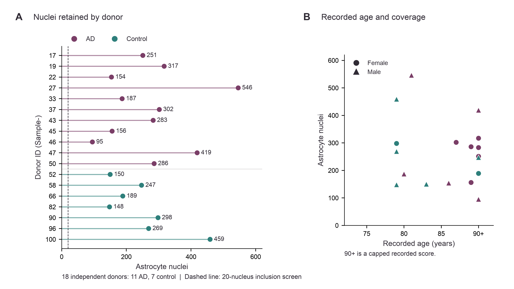
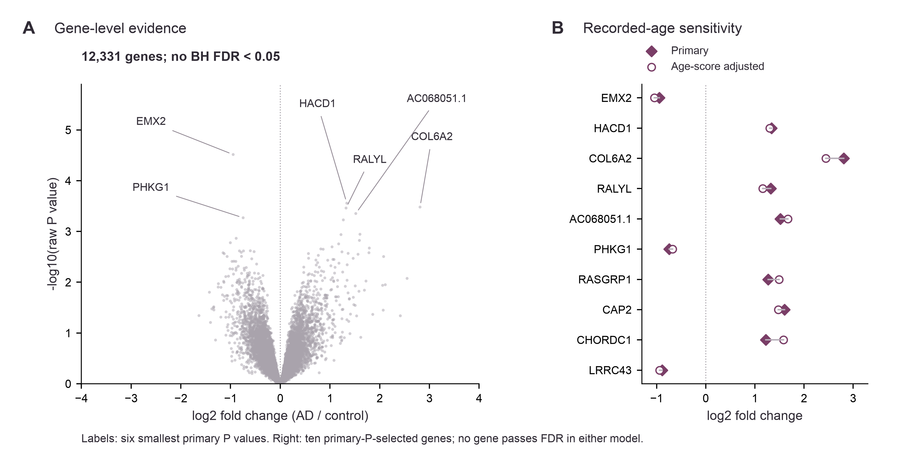
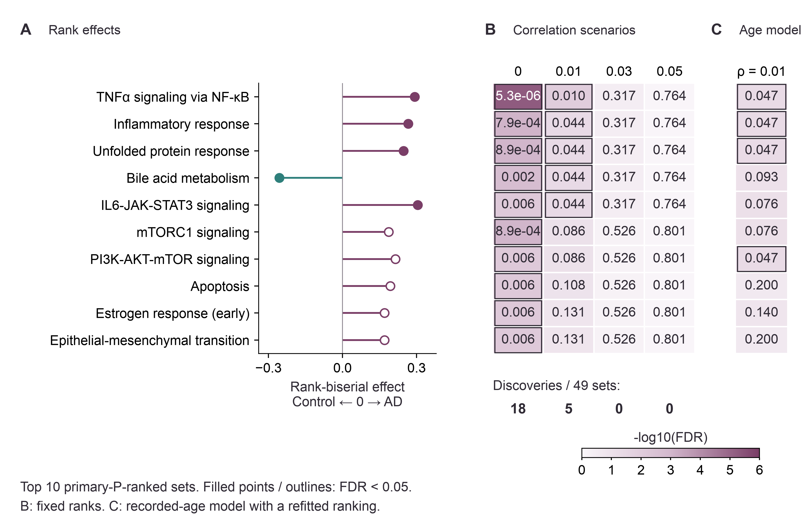
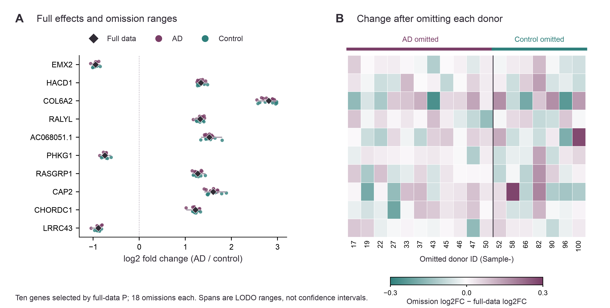

# Astrocyte expression in Alzheimer's disease: a donor-level reanalysis

**Zilong Wang**

Université Paris-Saclay | Master 2 Bioinformatics & Biostatistics

Research project report | Project period: August 2026

## Abstract

This project compared astrocyte expression in 11 Alzheimer's disease (AD) and 7 control donors using public single-nucleus RNA-seq data. Counts from 4,756 annotated nuclei were combined within each donor and analysed with edgeR. No individual gene passed multiple-testing correction. Five of 49 Hallmark gene sets met the default significance threshold, including inflammatory and protein-stress sets that ranked toward AD. Age adjustment, different correlation assumptions and donor omissions showed that their statistical support was sensitive to analysis choices.

## Introduction

Astrocytes show inflammatory, protein-handling and cell-state differences in AD [1,2]. Single-nucleus studies also report variation with disease stage and sex [3]. The public prefrontal-cortex dataset of Morabito et al. [4] makes it possible to examine these patterns across donors.

I processed the public count matrix into donor-level profiles and compared astrocyte expression between AD and control donors. Combining nuclei within each person avoids treating them as independent biological samples [5]. I then examined whether the gene-set results changed with age adjustment, assumed gene correlation or the removal of individual donors.

## Methods

Processed counts and the authors' ASC astrocyte labels came from GEO GSE174367 [4]. Barcodes were matched exactly, and donor identities were checked against original-study Supplementary Table 1. Integer UMI counts were summed within each donor (pseudobulk). All retained donors passed the screen of at least 20 astrocyte nuclei, with at least 5 donors per group. The authors' Cell Ranger aggregation, read-depth subsampling and GRCh38.p12 pre-mRNA reference were retained.

The primary edgeR v4 model was ~ diagnosis, with control as reference [6]. Low-expression filtering, TMM normalization [7] and robust quasi-likelihood inference preceded Benjamini-Hochberg (BH) correction across all tested genes. FDR < 0.05 defined significance; positive log2 fold change (log2FC) means higher expression in AD.

Hallmark 2026.1.Hs gene sets [9] were tested with cameraPR [8]. The ranking was sign(log2FC) × sqrt(QL F), after unique symbol mapping and a 15-500-gene coverage rule. BH correction covered all eligible sets. Correlation scenarios (0, 0.01, 0.03 and 0.05) used the same ranking and memberships; these are assumptions, not estimates from the donors. Rank-biserial effects compare set-gene ranks with the remaining genes.

A supplementary model added centered recorded age. Values of 90 denote age 90 or older; no unknown age was imputed. This fit kept the gene universe, TMM factors and symbol/set mapping fixed. Leave-one-donor-out (LODO) fits instead re-estimated TMM and dispersion after each omission. The ten-gene display was selected by the smallest full-data P values.

Additional checks started from the included pseudobulk counts and first compared the full-data refit with saved results. Donor MDS used 500 high-variance genes and displayed diagnosis, recorded age, sex and both source batch fields on the same coordinates. Gene-set LODO retained the original gene universe and mapping, used correlation 0.01, and applied BH across all 49 sets in each omission. The original five sets remained the display panel even when nonsignificant. Supplementary Methods records the complete parameters and outputs.

<!-- PAGEBREAK -->

## Results

### Donor coverage and group differences

The analysis included 4,756 astrocyte nuclei from 18 independent donors, with 95-546 nuclei per donor and no coverage exclusions (Fig. 1). The AD group contained 6 female and 5 male donors, compared with 2 female and 5 male controls. Median recorded ages were 89 and 79 years. Supplementary Table S1 provides individual records, group summaries and both source batch assignments.

The first two MDS dimensions accounted for 24.4% and 18.9% of the common-gene expression variation (Supplementary Fig. S1). AD and control profiles overlap in this view, while recorded sex shows visible structure along the second dimension. All covariate views use the same coordinates and retain all donors.

**Figure 1 | Donor coverage and recorded age.** A, Each lollipop represents one of 11 AD (plum) or 7 control (teal) donors; labels give retained nuclei. The dashed line marks the 20-nucleus screen, passed by all donors. B, The same donors are plotted by recorded age and nucleus count; shapes indicate recorded sex. Ages of 90+ are top-coded, not exact ages.

### No individual gene passed correction

Of 58,721 features, 12,331 passed expression filtering. No individual gene met BH FDR < 0.05, with a minimum FDR of 0.376 (Fig. 2). EMX2 ranked first by raw P value: log2FC -0.947, P = 3.05e-05 and FDR = 0.376. This is an exploratory ranking, not a significant gene finding.

The recorded-age model also yielded 0 gene discoveries. EMX2 had log2FC -1.043 and FDR 0.453 in that model (Supplementary Table S3). Gene and gene-set tests use separate correction families.

**Figure 2 | Gene-level evidence and model sensitivity.** A, All 12,331 diagnosis-only quasi-likelihood estimates from 18 donors are shown against -log10(raw P). No gene passes BH FDR < 0.05; labels mark the six smallest primary P values. B, Primary (filled diamonds) and existing recorded-age-adjusted (open circles) log2FC are connected for the ten primary-P-selected genes. Positive effects are toward AD. Neither model yields gene-level discoveries; connecting segments are comparisons, not uncertainty intervals.

### Inflammatory and protein-stress programs rank toward AD

**Figure 3 | Hallmark effects and model-dependent evidence.** Rows are the ten smallest-P sets from the primary model. A, Rank-biserial effects point toward AD (plum) or control (teal); filled points meet default FDR < 0.05. B, Cell text gives FDR under four assumed correlations for the same ranking and 49-set family; the bottom counts cover the full family. C, FDR from the separately fitted recorded-age model is aligned to the same displayed sets. Color encodes -log10(FDR), and outlines mark FDR < 0.05. These values are evidence statistics, not pathway-activity measurements. Complete scenarios and age results are in Supplementary Tables S2-S3.

The ranked analysis retained 12,328 unique symbols and 49 eligible Hallmark sets. At the default correlation, 5 sets met BH FDR < 0.05 (Fig. 3). TNFα signaling via NF-κB, inflammatory response, unfolded protein response and IL6-JAK-STAT3 signaling ranked toward AD; bile acid metabolism ranked in the opposite direction. TNFα/NF-κB had the lowest FDR (0.0098) and a rank-biserial effect of 0.292. The remaining four FDR values ranged from 0.0435 to 0.0437.

The numbers of significant sets were 18, 5, 0 and 0 at correlations 0, 0.01, 0.03 and 0.05, respectively. The original five sets had FDR 0.317 at 0.03 and 0.764 at 0.05 (Supplementary Table S2). The ranking was held fixed, so directions and rank effects did not change; significance depended on the correlation assumption.

At the default correlation, the recorded-age model retained 3 of the original sets: TNFα/NF-κB, inflammatory response and unfolded protein response, each with FDR 0.0471. IL6-JAK-STAT3 and bile acid metabolism had FDR 0.0764 and 0.0926. PI3K-AKT-mTOR signaling and protein secretion also crossed the threshold, giving 5 sets overall (Supplementary Table S3). The model had rank 3 and 15 nominal residual degrees of freedom. However, the only exactly shared recorded age was the 90+ category. Adjustment cannot recover age differences hidden within that category.

### Selected gene effects retain direction across donor omissions

All 10 displayed genes retained their effect direction across 18 donor omissions (Fig. 4). The maximum displayed change was 0.288 log2FC for CAP2 after removing Sample-58. For EMX2, the estimates ranged from -1.053 to -0.846. This consistency concerns the selected panel, not the complete transcriptome.

**Figure 4 | Donor-resolved sensitivity of selected effects.** Rows are the ten genes selected by smallest full-data P. A, Diamonds are full-data log2FC; points omit one AD (plum) or control (teal) donor, leaving 17 donors per fit. Spans are LODO ranges, not confidence intervals. B, Each cell is omission log2FC minus full-data log2FC, with columns retaining donor identity. Plum and teal encode positive and negative changes on a symmetric scale; the upper strip identifies the omitted donor's diagnosis.

### Gene-set significance varied across donor omissions

Among the five original Hallmark discoveries, 5 retained their rank-effect direction in all 18 omissions. Each set remained below BH FDR < 0.05 in 9-11 omissions, and the largest absolute change in rank-biserial effect was 0.187 (Supplementary Fig. S2 and Table S4). Direction was more consistent than significance under this fixed mapping and correlation assumption. The overlapping omissions are internal sensitivity checks, not external validation or confidence intervals.

<!-- PAGEBREAK -->

## Discussion

The inflammatory and protein-stress rankings fit with observations from earlier astrocyte studies. Microglial TNFα, IL-1α and C1q can induce a reactive phenotype in rodent astrocyte culture [10], and human astrocyte subtypes show protein-folding and stress-related expression differences [1]. These studies help interpret the ranked sets, but the present expression data do not establish the same functional state or mechanism.

A more immediate finding is how much the list of significant sets depends on the analysis. Changing the assumed gene correlation altered significance without changing the underlying ranking. Removing individual donors also changed which sets passed the threshold, even when their direction stayed the same. The full sensitivity results are therefore as relevant to the interpretation as the default list of five sets.

The cohort limits what can be separated in this comparison. The primary model is unadjusted, age and sex differ between groups, and conflicting batch assignments prevent a clear account of technical effects. Pseudobulk expression may also combine changes in astrocyte-state proportions with changes within a state [1,2,4]. Published annotations and processing were retained, and both LODO displays were selected from full-data results. Testing whether the patterns extend beyond these 18 donors would require an independent cohort with clearer covariates and cell-state information.

## Data and code availability

GEO GSE174367 provides the source data [4]. The accompanying repository contains the analysis code, complete result tables and report sources. Hallmark 2026.1.Hs is attributed to MSigDB [9] under its documented CC BY 4.0 terms [11]. Supplementary Methods contains detailed parameters, metadata and statistical tables; the repository validation record documents computational checks.

## References

1. Sadick JS, O'Dea MR, Hasel P, Dykstra T, Faustin A, Liddelow SA. Astrocytes and oligodendrocytes undergo subtype-specific transcriptional changes in Alzheimer's disease. *Neuron*. 2022;110:1788-1805.e10. https://doi.org/10.1016/j.neuron.2022.03.008

2. Habib N, McCabe C, Medina S, et al. Disease-associated astrocytes in Alzheimer's disease and aging. *Nature Neuroscience*. 2020;23:701-706. https://doi.org/10.1038/s41593-020-0624-8

3. Mathys H, Davila-Velderrain J, Peng Z, et al. Single-cell transcriptomic analysis of Alzheimer's disease. *Nature*. 2019;570:332-337. https://doi.org/10.1038/s41586-019-1195-2

4. Morabito S, Miyoshi E, Michael N, et al. Single-nucleus chromatin accessibility and transcriptomic characterization of Alzheimer's disease. *Nature Genetics*. 2021;53:1143-1155. https://doi.org/10.1038/s41588-021-00894-z

5. Squair JW, Gautier M, Kathe C, et al. Confronting false discoveries in single-cell differential expression. *Nature Communications*. 2021;12:5692. https://doi.org/10.1038/s41467-021-25960-2

6. Chen Y, Chen L, Lun ATL, Baldoni PL, Smyth GK. edgeR v4: powerful differential analysis of sequencing data with expanded functionality and improved support for small counts and larger datasets. *Nucleic Acids Research*. 2025;53:gkaf018. https://doi.org/10.1093/nar/gkaf018

7. Robinson MD, Oshlack A. A scaling normalization method for differential expression analysis of RNA-seq data. *Genome Biology*. 2010;11:R25. https://doi.org/10.1186/gb-2010-11-3-r25

8. Wu D, Smyth GK. Camera: a competitive gene set test accounting for inter-gene correlation. *Nucleic Acids Research*. 2012;40:e133. https://doi.org/10.1093/nar/gks461

9. Liberzon A, Birger C, Thorvaldsdóttir H, Ghandi M, Mesirov JP, Tamayo P. The Molecular Signatures Database (MSigDB) hallmark gene set collection. *Cell Systems*. 2015;1:417-425. https://doi.org/10.1016/j.cels.2015.12.004

10. Liddelow SA, Guttenplan KA, Clarke LE, et al. Neurotoxic reactive astrocytes are induced by activated microglia. *Nature*. 2017;541:481-487. https://doi.org/10.1038/nature21029

11. MSigDB. License Terms for MSigDB released after April 2017. Accessed October 2026. https://www.gsea-msigdb.org/gsea/msigdb_license_terms.jsp
