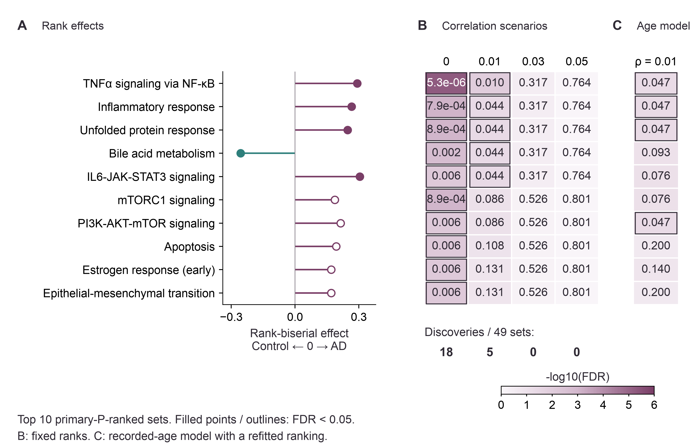

# Astrocyte expression in Alzheimer's disease: a donor-level reanalysis

**Zilong Wang** | Université Paris-Saclay, Master 2 Bioinformatics & Biostatistics

Research project summary | Project period: August 2026

## Research question and approach

Using public GSE174367 data, I combined counts from 4,756 astrocyte nuclei into profiles for 11 AD and 7 control donors. I compared the groups with edgeR, then checked how age adjustment, gene correlation assumptions and donor omissions affected the results. The donor, rather than each nucleus, was the biological replicate.

## Findings

No individual gene passed correction among 12,331 tested genes. Inflammatory and protein-stress gene sets ranked toward AD. At the default correlation of 0.01, 5 of 49 Hallmark sets met BH FDR < 0.05. Age adjustment retained 3 of the original five; none remained significant at correlations 0.03 or 0.05. All five kept their direction across 18 donor omissions, but each met FDR < 0.05 in only 9-11 omissions.

**Figure | Program ranking and statistical support.** A, Primary rank-biserial effects; filled points meet default FDR < 0.05. B, FDR across four assumed correlations, holding ranks fixed. C, The recorded-age model. Outlined cells meet the same FDR threshold; color shows evidence, not pathway activity.

**Interpretation.** The gene-set rankings describe this cohort, with statistical support that depends on the model. Age and sex imbalance, capped ages and conflicting batch labels limit the comparison; donor-level expression also mixes cell-state proportions with expression within states. The overlapping donor omissions do not provide independent validation.

**Data and code.** Morabito et al., Nature Genetics (2021), doi:10.1038/s41588-021-00894-z; GEO GSE174367. Code, complete tables and supplementary methods accompany the report.
